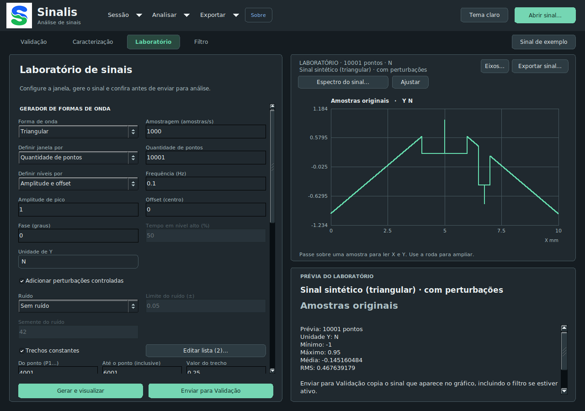

<p align="center"></p>

# Sinalis

O Sinalis é um aplicativo de análise de sinais para Windows e Linux. Abra uma
captura em JSON, CSV ou TXT, examine a forma de onda e compare as medidas com
os limites do seu ensaio. Você pode salvar os dados, os critérios e os filtros
numa sessão para retomar o trabalho depois. A análise é feita no seu computador.



## Download

| Sistema | Sinalis 0.17.0 |
|---|---|
| Ubuntu 24.04/26.04 e Debian 12/13 (amd64) | [Baixar instalador Linux](https://github.com/IcaroRamosDM/Sinalis/releases/download/v0.17.0/sinalis_0.17.0_amd64.deb) |
| Windows x64 | [Baixar ZIP para Windows](https://github.com/IcaroRamosDM/Sinalis/releases/download/v0.17.0/Sinalis-0.17.0-Windows-x64.zip) |

No Linux, abra um terminal na pasta do download e instale o pacote. Depois,
procure **Sinalis** no menu de aplicativos.

```sh
sudo apt install ./sinalis_0.17.0_amd64.deb
```

No Windows, extraia o ZIP inteiro e abra `Sinalis.exe` na pasta `Sinalis`.
Mantenha a pasta `examples` junto ao executável. O pacote Windows ainda aguarda
teste nativo e o executável está sem assinatura digital.

[Outras versões](https://github.com/IcaroRamosDM/Sinalis/releases) · [Hashes SHA-256 dos downloads](https://github.com/IcaroRamosDM/Sinalis/releases/download/v0.17.0/SHA256SUMS.txt)

## Primeiro uso

Em **Sessão → Exemplos guiados…**, escolha **Medições por etapas** para avaliar
nove posições em milímetros ou **Sinal temporal e filtragem** para trabalhar
com uma senoide de 100 Hz. Para analisar seus dados, clique em **Abrir sinal…**.

- **Validação** compara a captura com as regras do modelo e mostra o resultado de cada critério.
- **Caracterização** mostra estatísticas, picos e espectro. Com uma base de tempo regular, também mede período e frequência.
- **Laboratório** gera sinais de teste e permite acrescentar ruído, pulsos e falhas pontuais.
- **Filtro** mostra entrada e saída lado a lado. Você pode exportar o resultado ou encadear filtros.

[Guia de uso e atalhos](USO.md) · [Exemplos passo a passo](EXEMPLOS.md) · [Formatos de arquivo](COMPATIBILIDADE.md) · [Histórico de versões](CHANGELOG.md)

## Licença

O Sinalis é um aplicativo de código fechado, escrito em C17 e C++17 com FLTK.
O uso pessoal e educacional é gratuito, inclusive em instituições de ensino
particulares. O uso comercial requer autorização prévia do autor.
[Licença de uso](LICENSE.md)

## Autoria e contato

**Icaro Ramos Rodrigues dos Santos**<br>
Engenheiro Eletrônico

Embedded Systems | Firmware | C | C++ | Python | Dart | Assembly | Hardware Design | PCB Design | STM32 | ARM Cortex-M | Linux | Windows | RISC-V | Verilog | SystemVerilog | UVM | Design Verification | Instrumentation | Signal Processing | Qt | FLTK

GitHub: [IcaroRamosDM](https://github.com/IcaroRamosDM)<br>
LinkedIn: [icaro-ramos-r](https://www.linkedin.com/in/icaro-ramos-r/)<br>
[icaroelt@gmail.com](mailto:icaroelt@gmail.com)

[Relatar problema](https://github.com/IcaroRamosDM/Sinalis/issues)

Ao relatar um problema, informe versão do programa, sistema operacional e passos
para reproduzi-lo. Anexe somente exemplos que possam ser tornados públicos,
sem dados de clientes, medições confidenciais ou informações pessoais.

## Agradecimentos e dependências

Sinalis is based in part on the work of the FLTK project (https://www.fltk.org).
This software is based in part on the work of the Independent JPEG Group.

Consulte [THIRD_PARTY_NOTICES.md](THIRD_PARTY_NOTICES.md). Os textos das licenças
de terceiros acompanham os pacotes de download na pasta `licenses` (Windows)
ou em `/usr/share/doc/sinalis/licenses` (Linux).

[](https://github.com/IcaroRamosDM/Sinalis/actions/workflows/checks.yml)
