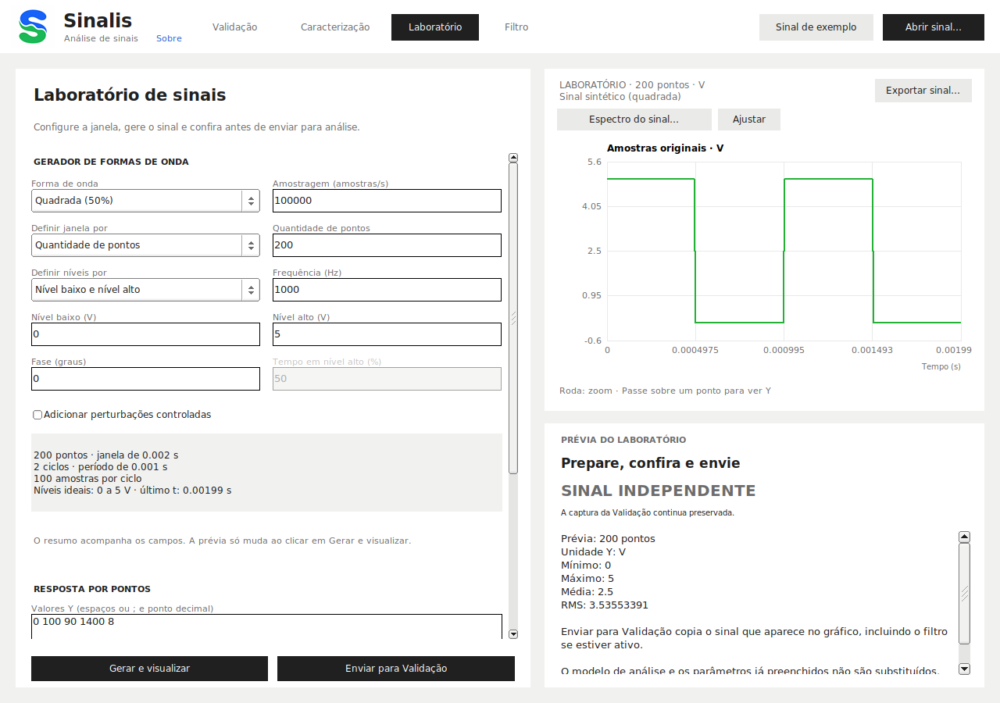

<p align="center"></p>

# Sinalis

**Visualize, caracterize, gere, filtre e valide sinais em uma interface gráfica.**

O Sinalis é um aplicativo de análise offline para Windows e Linux, com interface
em português. Você pode explorar sinais de teste, experimentar filtros e
avaliar medições usando modelos com critérios configuráveis.

Este repositório contém apenas a apresentação e os termos de distribuição.
**O código-fonte e o histórico de desenvolvimento não são publicados aqui.**

## Download — versão 0.14.2

| Sistema | Download | Como abrir |
|---|---|---|
| Windows x64 | [Sinalis-0.14.2-Windows-x64.zip](https://github.com/IcaroRamosDM/Sinalis/releases/download/v0.14.2/Sinalis-0.14.2-Windows-x64.zip) | Extraia o ZIP inteiro e dê dois cliques em `Sinalis.exe` |
| Ubuntu / Debian amd64 | [sinalis_0.14.2_amd64.deb](https://github.com/IcaroRamosDM/Sinalis/releases/download/v0.14.2/sinalis_0.14.2_amd64.deb) | Instale o pacote e procure **Sinalis** no menu do sistema |

[Todas as versões e arquivos](https://github.com/IcaroRamosDM/Sinalis/releases)
· [SHA-256 dos downloads](https://github.com/IcaroRamosDM/Sinalis/releases/download/v0.14.2/SHA256SUMS.txt)

Na página da versão, abra **Assets** e escolha um dos dois pacotes acima.
Os itens automáticos **Source code (zip)** e **Source code (tar.gz)** do GitHub
contêm apenas os arquivos desta página, não o aplicativo nem seu código-fonte.

## Permissão de uso

- **Gratuito para uso pessoal e educacional.**
- **Instituições de ensino públicas e particulares estão incluídas**, mesmo
  quando cobram mensalidades ou pelos cursos.
- **Uso comercial requer solicitação e autorização prévia do autor.**

A permissão educacional não cobre automaticamente serviços comerciais a
terceiros. Consulte os termos completos em [LICENSE.md](LICENSE.md).

## O que você pode fazer

| Área | Principais recursos |
|---|---|
| **Validação** | Modelos de análise com várias regras, resultados por critério, tolerâncias, conjuntos alternativos, envelope de aprovação e critérios por interpolação de Lagrange |
| **Caracterização** | Quantidade de pontos, extremos, média, RMS, pico a pico, informações do sinal e espectro FFT/Welch |
| **Laboratório** | Senoide, quadrada, pulso, triangular, dentes de serra, pulso único, rajada, sequência por pontos, ruído reprodutível e falhas controladas |
| **Filtro** | Comparação antes/depois, média móvel, EMA, mediana, IIR, notch, FIR, Savitzky–Golay, Hampel, gaussiano, média aparada, wavelets e sugestões automáticas |



### Arquivos e modelos

- **Entrada de sinais:** JSON com estruturas reconhecidas, CSV e TXT numéricos.
  Se houver diferentes sinais possíveis no JSON, a importação pode pedir que
  você escolha o conjunto correto. Não é um leitor universal de qualquer JSON.
- **Saída de sinais:** JSON, CSV ou TXT.
- **Modelos de validação:** JSON, salvos com o prefixo `TEST_`.
- **Relatórios de avaliação:** JSON, com o prefixo `EVAL_` no fluxo de arquivos.
- **Configurações de filtros:** JSON.

Em **Avaliar arquivos**, selecione o sinal e o modelo para gerar o relatório.
Na correspondência automática, `ensaio.json` é associado a `TEST_ensaio.json`
na mesma pasta, produzindo `EVAL_ensaio.json`. Os originais são preservados.

## Instalação

### Windows

1. Baixe `Sinalis-0.14.2-Windows-x64.zip`.
2. No Explorador de Arquivos, clique com o botão direito no ZIP e escolha
   **Extrair Tudo…**.
3. Abra a pasta extraída `Sinalis` e dê dois cliques em **Sinalis.exe**.

Mantenha a pasta `examples` junto dos executáveis. Não é necessário instalar
Ubuntu, WSL, compilador ou ferramentas de desenvolvimento. O pacote é portátil:
para removê-lo, feche o programa e exclua a pasta extraída, preservando os
sinais, modelos e relatórios que você queira guardar.

O executável não tem assinatura digital de editor. Se o Windows ou a política
da sua instituição bloquear a execução, não desative as proteções; consulte o
administrador ou reporte o problema. A verificação SHA-256 abaixo detecta
diferenças no download, mas não substitui uma assinatura digital.

### Ubuntu e Debian

O pacote é destinado a **Ubuntu 24.04/26.04 e Debian 12/13, arquitetura
amd64/x86-64**, com ambiente gráfico. ARM64, macOS e outras distribuições não
estão cobertos por este pacote.

1. Baixe `sinalis_0.14.2_amd64.deb`.
2. Abra a pasta do download no gerenciador de arquivos e use **Abrir no
   terminal**.
3. Nesse terminal, execute:

   ```bash
   sudo apt install ./sinalis_0.14.2_amd64.deb
   ```

4. Aguarde a instalação, abra o menu/pesquisa de aplicativos e procure
   **Sinalis**. Também é possível abrir pelo comando `sinalis`.

O APT resolve as dependências do sistema; pode ser necessária conexão à
internet durante a instalação. O aplicativo usa X11; sessões Wayland precisam
de XWayland. Ele não define automaticamente o aplicativo padrão dos seus JSON
e CSV, nem inicia com o sistema.

Para desinstalar:

```bash
sudo apt remove sinalis
```

Os exemplos instalados ficam em `/usr/share/sinalis/examples`. Copie os arquivos
que quiser editar para uma pasta sua. Não salve relatórios na pasta de instalação.

### Verificar o download

Baixe `SHA256SUMS.txt` na mesma página da versão. Compare a linha correspondente
ao seu pacote com o resultado do comando abaixo, executado na pasta do download.

Windows, no PowerShell:

```powershell
Get-FileHash -Algorithm SHA256 .\Sinalis-0.14.2-Windows-x64.zip
```

Linux:

```bash
sha256sum sinalis_0.14.2_amd64.deb
```

Os 64 caracteres do hash devem coincidir, desconsiderando maiúsculas/minúsculas.
Se houver diferença, não use o arquivo e faça um novo download da página oficial.

## Primeiro uso

1. Abra o Sinalis e clique em **Sinal de exemplo**, ou use **Abrir sinal…**
   para carregar seus próprios dados.
2. Em **Caracterização**, confira os valores e as unidades do sinal.
3. Em **Validação**, configure os critérios, salve o modelo e avalie os dados.
   Um modelo de demonstração não é uma especificação técnica da sua aplicação.
4. Em **Laboratório**, gere um sinal e envie-o para **Validação** ou **Filtro**.
5. Em **Filtro**, compare o original com a saída antes de exportá-la.

A pasta `examples` traz pequenos sinais e modelos didáticos. Os limites dos
modelos são ilustrativos: ajuste-os conforme a finalidade da sua análise.

Os pacotes também incluem uma ferramenta de terminal opcional. Para consultar
os comandos, execute `sinalis-cli` sem argumentos no Linux ou
`./waveform-cli.exe` sem argumentos no PowerShell aberto na pasta Windows
extraída. Nenhum terminal é necessário
para o uso normal da interface gráfica.

## Limitações e verificação desta versão

- A análise é **offline**. Não há aquisição por USB/serial, controle de placa,
  leitura de fotos de gráficos ou importação XLSX.
- Unidades são informadas pelo usuário; o programa não faz conversão física
  automática entre unidades diferentes.
- Sugestões de filtros são heurísticas. Não garantem a recuperação do sinal
  ideal e podem suavizar características úteis. Compare sempre original e saída.
- Uma interpolação pode oscilar entre pontos; nós usados para construir a curva
  não oferecem uma comparação independente. Mostrar Lagrange e validar por
  Lagrange são opções diferentes.
- **Aprovado** significa atendimento aos critérios configurados, não aprovação
  física ou certificação industrial. **Inconclusivo** não deve ser interpretado
  como aprovação.
- O pacote Linux desta distribuição foi verificado em ambientes isolados de
  Ubuntu 24.04/26.04 e Debian 12/13, com instalação, dependências, registro no
  menu, fluxo de arquivos e testes gráficos em Xvfb. Isso não equivale a teste
  manual em todos os desktops ou equipamentos.
- O executável Windows x64 foi compilado e inspecionado. A execução nativa desta
  versão não foi validada no ambiente de publicação; relatos de compatibilidade
  são bem-vindos. Não há garantia para versões futuras dos sistemas.

## Autoria e contato

**Ícaro Ramos Rodrigues dos Santos**  
Engenheiro Eletrônico

[GitHub](https://github.com/IcaroRamosDM)
· [LinkedIn e pedidos de autorização comercial](https://www.linkedin.com/in/icaro-ramos-r/)
· [Relatar problema](https://github.com/IcaroRamosDM/Sinalis/issues)

Ao relatar um problema, informe versão do programa, sistema operacional e passos
para reproduzi-lo. Anexe somente exemplos que possam ser tornados públicos,
sem dados de clientes, medições confidenciais ou informações pessoais.

## Agradecimentos e dependências

Sinalis is based in part on the work of the FLTK project (https://www.fltk.org).
This software is based in part on the work of the Independent JPEG Group.

Consulte [THIRD_PARTY_NOTICES.md](THIRD_PARTY_NOTICES.md). Os textos das licenças
de terceiros acompanham os pacotes de download na pasta `licenses` (Windows)
ou em `/usr/share/doc/sinalis/licenses` (Linux).
